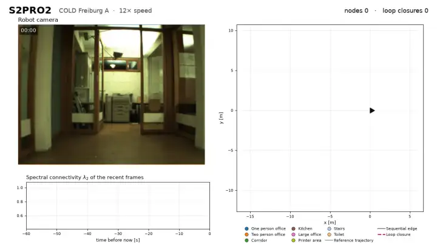
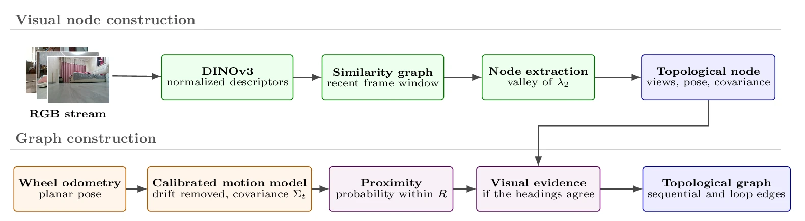

# S2PRO2

**Online visual topological mapping with spectral segmentation and probability of proximity**

[](assets/readme/freiburg_a.mp4)

*S2PRO2 mapping a traversal of COLD Freiburg A at 12× speed: the robot camera, the spectral
connectivity that places the node boundaries, and the map with its loop closures, drawn at reference
positions. Click the animation for the [full-quality MP4](assets/readme/freiburg_a.mp4).*

## The problem

A topological map describes an environment as places and the connections between them. Building
one online from a robot requires two decisions at every step: when the camera has entered a new
place, and whether that place has been visited before. A wrong revisit corrupts the map, and a
missed one leaves it disconnected.

S2PRO2 makes both decisions from a monocular camera and wheel odometry, with frozen image
descriptors.

## How it works



- **Nodes.** Each frame is encoded with a frozen DINOv3 ViT-S/16. The recent frames form a
  similarity graph whose algebraic connectivity $\lambda_2$ drops while two appearances share
  the window. A node boundary is placed at the bottom of each valley, accepted once the signal has
  risen by a margin that adapts to its recent variation.
- **Odometry.** A constant heading drift is estimated once per robot and removed, and the
  remaining error is propagated as a covariance whose noise coefficients are fitted by maximum
  likelihood against reference trajectories.
- **Loop closure.** For each new node, the mapper computes the probability that an earlier node
  lies within 2 m. Visual similarity updates that probability only when both nodes were seen from
  a similar heading, and a loop edge is added when the result exceeds 0.5.

## Results

Loop closure at 2 m on 62 test traversals of COLD and CID-SIMS, none of them used for design:

| Configuration | Precision | Recall | $F_1$ |
|---|---:|---:|---:|
| **S2PRO2** | **0.900** | 0.780 | **0.836** |
| AnyLoc VLAD descriptor, DINOv2 ViT-G/14 | 0.831 | 0.802 | 0.816 |
| AnyLoc GeM descriptor, DINOv2 ViT-G/14 | 0.836 | 0.725 | 0.777 |
| S2PRO2 without the drift correction | 0.837 | 0.621 | 0.713 |
| χ² gate on the same covariance | 0.717 | 0.470 | 0.568 |

A small frozen descriptor performs as well as AnyLoc backbones about fifty times larger, while the
odometry model matters most: four of every five revisits in these data are made in the opposite
direction, where a forward camera cannot confirm the place. Every number comes from
[`experiments/manuscript_gpu/results/`](experiments/manuscript_gpu/results).

## Repository structure

```text
.
├── experiments/
│   ├── manuscript_gpu/          Runners, calibration, replays and results of the paper
│   ├── anyloc_published/
│   │   ├── historical_src/      The mapper evaluated in the paper
│   │   └── ...                  Dataset downloads, descriptor extraction, AnyLoc baselines
│   └── ...                      Earlier studies, kept for traceability
├── assets/readme/               Figures and video of this README
├── vts_devcontainer/            Ongoing multi-session work and ROS 2 packages (see below)
└── encoder/                     Datasets, downloaded by the runners (ignored by Git)
```

## Running it

### Requirements

- Linux with an NVIDIA GPU. The paper used an RTX 4070 Ti with 12 GB, which the AnyLoc
  ViT-G/14 baselines need.
- [uv](https://docs.astral.sh/uv/), `git`, `curl`, `tar`, `unzip` and `md5sum`. The runners create
  their own Python environment with PyTorch.
- Access to the gated [DINOv3 weights](https://huggingface.co/facebook/dinov3-vits16-pretrain-lvd1689m):
  request it on Hugging Face and run `hf auth login`.
- Disk space for the datasets: the test set alone takes about 100 GB of downloads and 70 GB once
  extracted.

### Steps

Clone the full repository: the test runner checks the method against a commit in its history.

```bash
git clone https://github.com/manuel-rodriguezvillegas/s2pro2.git && cd s2pro2
```

Every runner is resumable: it downloads only what is missing, checks MD5 sums and skips finished
work, so it can be relaunched after an interruption. Run them from the repository root.

1. **Design set** (19 traversals): downloads the data, extracts the descriptors, calibrates the
   odometry and the visual likelihood, runs the mapper and its ablations, and draws the figures.

   ```bash
   nohup bash experiments/manuscript_gpu/run_all.sh > manuscript_gpu.log 2>&1 &
   ```

2. **Test set** (62 traversals): downloads the data and extracts the descriptors, then evaluates
   the frozen method once. The evaluation stops if the method code or its calibration differ from
   the frozen version.

   ```bash
   nohup bash experiments/manuscript_gpu/fetch_test_set.sh > fetch_test_set.log 2>&1 &
   ```

   ```bash
   nohup bash experiments/manuscript_gpu/run_test.sh > manuscript_test.log 2>&1 &
   ```

3. **Videos** (optional): renders the video above after step 1.

   ```bash
   nohup bash experiments/manuscript_gpu/run_video.sh > manuscript_video.log 2>&1 &
   ```

The summaries are written to `experiments/manuscript_gpu/results/` (`summary.md` and
`test_summary.md`). The maps of each traversal are saved under
`vts_devcontainer/vts_ws/output/manuscript_gpu/replay/<traversal>/topo_debiased/`.

## Datasets

The datasets are downloaded by the runners and are not redistributed here; their licenses remain
with their authors.

- [COLD](https://www.cas.kth.se/COLD/): the CoSy Localization Database, recorded in three
  laboratories in Freiburg, Saarbrücken and Ljubljana.
- [CID-SIMS](https://doi.org/10.57760/sciencedb.ai.00003): the Complex Indoor Dataset with
  Semantic Information and Multi-Sensor Data, with apartments and office floors.

## Ongoing work

[`vts_devcontainer/`](vts_devcontainer/README.md) holds a later rewrite of the engine for
multi-session mapping, with a command line and ROS 2 packages. It does not produce the numbers of
the paper.

## Citation

The accompanying paper will soon be submitted for publication. Until it is published, please cite the software with the
metadata in [`CITATION.cff`](CITATION.cff).

## License

S2PRO2 is released under the [MIT License](LICENSE). Dataset and pretrained model licenses remain
with their respective authors.
